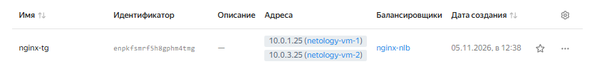
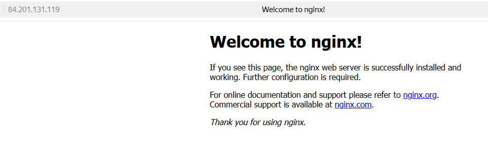

# Домашнее задание к занятию `«Отказоустойчивость в облаке»` - `Салмин Евгений`

### Задание 1
Возьмите за основу решение к заданию 1 из занятия «Подъём инфраструктуры в Яндекс Облаке».

Теперь вместо одной виртуальной машины сделайте terraform playbook, который:
создаст 2 идентичные виртуальные машины. Используйте аргумент count для создания таких ресурсов;
создаст таргет-группу. Поместите в неё созданные на шаге 1 виртуальные машины;
создаст сетевой балансировщик нагрузки, который слушает на порту 80, отправляет трафик на порт 80 виртуальных машин и http healthcheck на порт 80 виртуальных машин.
Рекомендуем изучить документацию сетевого балансировщика нагрузки для того, чтобы было понятно, что вы сделали.

Установите на созданные виртуальные машины пакет Nginx любым удобным способом и запустите Nginx веб-сервер на порту 80.

Перейдите в веб-консоль Yandex Cloud и убедитесь, что:

созданный балансировщик находится в статусе Active,
обе виртуальные машины в целевой группе находятся в состоянии healthy.
Сделайте запрос на 80 порт на внешний IP-адрес балансировщика и убедитесь, что вы получаете ответ в виде дефолтной страницы Nginx.
В качестве результата пришлите:

1. Terraform Playbook.

2. Скриншот статуса балансировщика и целевой группы.

3. Скриншот страницы, которая открылась при запросе IP-адреса балансировщика.

### Решение 1

В ходе выполнения задания был написан Terraform Playbook, который создает:
- 2 идентичные виртуальные машины (в разных зонах доступности для отказоустойчивости);
- целевую группу, в которую помещены эти ВМ;
- сетевой балансировщик нагрузки, слушающий порт 80 и проверяющий здоровье ВМ по HTTP.

На виртуальные машины через `user-data` (cloud-init) автоматически устанавливается и запускается веб-сервер Nginx на порту 80.

# Домашнее задание к занятию «Отказоустойчивость в облаке»

**Выполнил:** Твоя Фамилия Имя

## Задание 1

В ходе выполнения задания был написан Terraform Playbook, который создает отказоустойчивую инфраструктуру:
- **2 идентичные виртуальные машины** (созданы в разных зонах доступности `ru-central1-a` и `ru-central1-d` для обеспечения отказоустойчивости).
- **Целевая группа**, в которую автоматически помещены обе ВМ.
- **Сетевой балансировщик нагрузки**, который слушает порт 80, перенаправляет трафик на порт 80 виртуальных машин и выполняет HTTP healthcheck.

Установка и запуск веб-сервера Nginx на порту 80 на виртуальных машинах происходит автоматически при их создании благодаря блоку `metadata` (cloud-init).

`Terraform Playbook (main.tf)`

```
terraform {
  required_providers {
    yandex = {
      source = "yandex-cloud/yandex"
    }
  }
}

variable "yc_token" {}
variable "yc_cloud_id" {}
variable "yc_folder_id" {}

provider "yandex" {
  token     = var.yc_token
  cloud_id  = var.yc_cloud_id
  folder_id = var.yc_folder_id
  zone      = "ru-central1-a"
}

resource "yandex_vpc_network" "net" {
  name = "hw-ha-net"
}

resource "yandex_vpc_subnet" "subnet_a" {
  name            = "hw-ha-subnet-a"
  zone            = "ru-central1-a"
  network_id      = yandex_vpc_network.net.id
  v4_cidr_blocks = ["10.0.1.0/24"]
}

resource "yandex_vpc_subnet" "subnet_d" {
  name            = "hw-ha-subnet-d"
  zone            = "ru-central1-d"
  network_id      = yandex_vpc_network.net.id
  v4_cidr_blocks = ["10.0.3.0/24"]
}

resource "yandex_compute_instance" "vm" {
  count = 2
  name  = "netology-vm-${count.index + 1}"
  zone  = count.index == 0 ? "ru-central1-a" : "ru-central1-d"
  platform_id = "standard-v3"

  resources {
    cores  = 2
    memory = 2
  }

  boot_disk {
    initialize_params {
      image_id = "fd8emvfmfoaordspe1jr"
    }
  }

  network_interface {
    subnet_id = count.index == 0 ? yandex_vpc_subnet.subnet_a.id : yandex_vpc_subnet.subnet_d.id
    nat       = true
  }

  metadata = {
    user-data = <<EOF
#!/bin/bash
apt-get update
apt-get install -y nginx
systemctl enable nginx
systemctl start nginx
EOF
  }
}

resource "yandex_lb_target_group" "tg" {
  name = "nginx-tg"

  dynamic "target" {
    for_each = yandex_compute_instance.vm
    content {
      subnet_id = target.value.network_interface[0].subnet_id
      address   = target.value.network_interface[0].ip_address
    }
  }
}

resource "yandex_lb_network_load_balancer" "nlb" {
  name = "nginx-nlb"

  listener {
    name = "http-listener"
    port = 80
    external_address_spec {
      ip_version = "ipv4"
    }
  }

  attached_target_group {
    target_group_id = yandex_lb_target_group.tg.id

    healthcheck {
      name = "http-check"
      http_options {
        port = 80
        path = "/"
      }
    }
  }
}

output "lb_ip" {
  value = one(one(yandex_lb_network_load_balancer.nlb.listener).external_address_spec).address
}
```
---
### Скриншоты по результатам задания

Скриншот-1:


Скриншот-2:



Скриншот-3:


